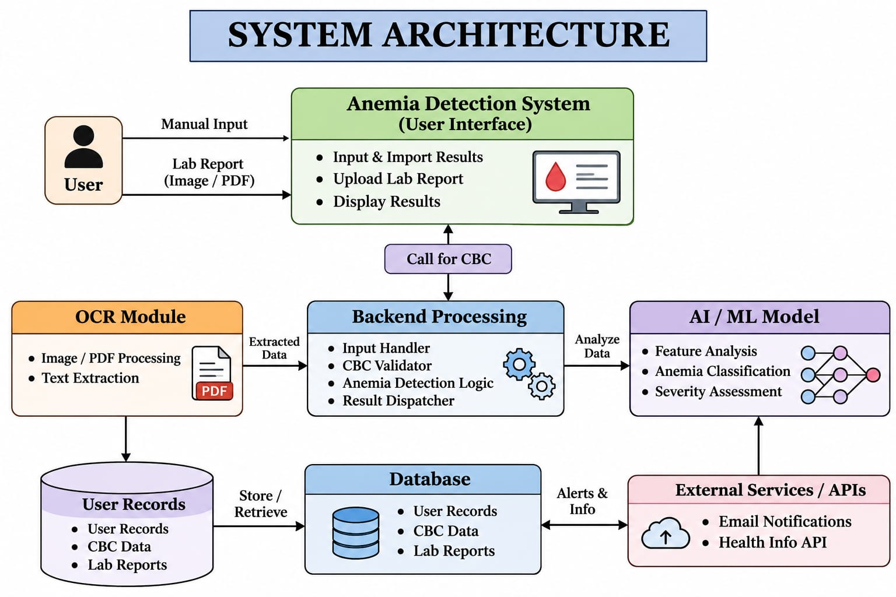
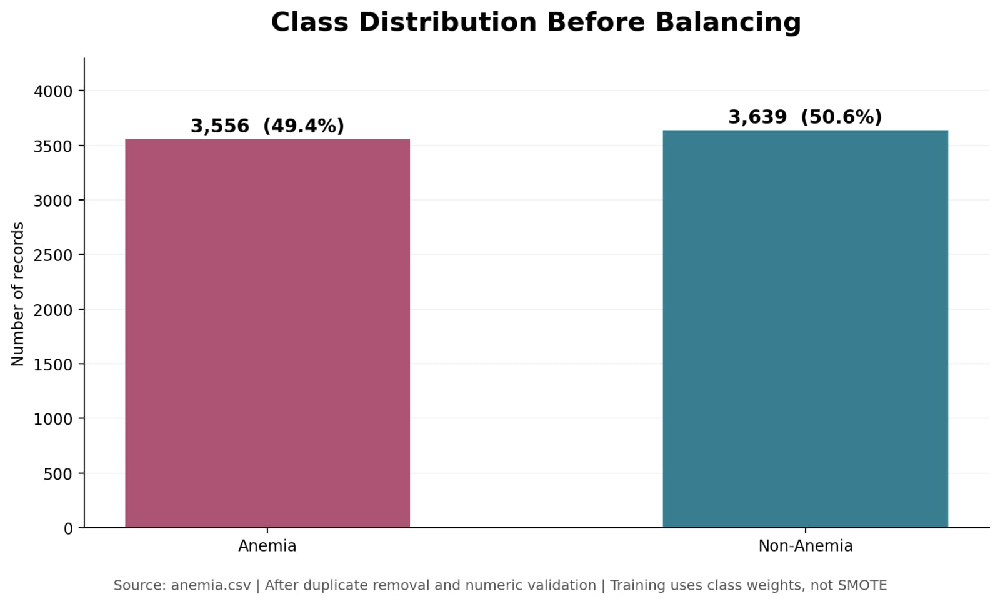
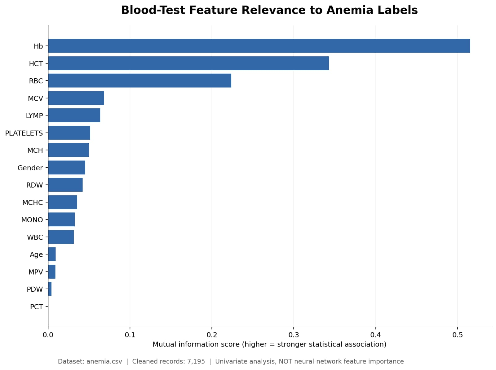

<div align="center">

# 🚑 Anemia Detection Using Deep Learning 🚑

*An intelligent AI-powered system for anemia prediction using Artificial Neural Networks and blood-test parameters*

[](https://www.python.org/)
[](https://www.tensorflow.org/)
[](https://keras.io/)
[](https://flask.palletsprojects.com/)
[](https://scikit-learn.org/)
[](LICENSE)


**Deep Learning | Healthcare AI | Medical Data Analysis | Predictive Analytics**

</div>

---

<div align="center">

## 🩸 Overview

</div>

This project implements a **Deep Learning-based Artificial Neural Network (ANN)** to predict whether an individual is anemic or non-anemic based on hematological and demographic attributes.

The project includes:

- 🧠 **TensorFlow/Keras-based Neural Network** for binary anemia classification
- 🌐 **Flask-based web application** for interactive predictions
- 📊 Data cleaning, preprocessing, encoding and feature scaling
- ⚖️ Class-weight balancing for handling imbalanced datasets
- 🎯 Model training with dropout, batch normalization and early stopping
- 📈 Performance evaluation using accuracy, confusion matrix and classification report
- 📸 Blood-report image processing components for automated data extraction
- 💾 Model and preprocessing artifact serialization for prediction workflows

---

<div align="center">

## ✨ Features

</div>

1. **Artificial Neural Network** for anemia classification
2. **TensorFlow and Keras** for deep learning model development
3. **StandardScaler** for numerical feature normalization
4. **Class Weights** to address dataset imbalance
5. **Dropout and Batch Normalization** to support model generalization
6. **Early Stopping** to reduce overfitting
7. **Flask Web Interface** for user interaction
8. **Blood Report Processing** through dedicated image and OCR-related modules
9. **Model Evaluation** using classification metrics
10. **Saved Model Artifacts** for reusable inference

---

<div align="center">

## 📊 Performance Evaluation

*Deep Learning Model Evaluation*

| Evaluation Metric | Implementation |
|:---:|:---:|
| Accuracy | `accuracy_score` |
| Precision | Classification Report |
| Recall | Classification Report |
| F1-Score | Classification Report |
| Confusion Matrix | `confusion_matrix` |
| Train-Test Split | 80% / 20% |

</div>

**Note:** Actual numerical performance results will be added after verifying the model's training output.

The model generates probabilities using a sigmoid output layer and applies a **0.5 classification threshold**.

---

<div align="center">

## 🏰 System Architecture



*The system follows a structured workflow from data preprocessing to anemia prediction.*

</div>

### 🔄 Deep Learning Workflow

```text
          Blood Test Dataset
                  |
                  v
         Data Preprocessing
                  |
                  v
       Cleaning & Encoding
                  |
                  v
        Feature Normalization
                  |
                  v
       Train-Test Split (80:20)
                  |
                  v
       Class Weight Balancing
                  |
                  v
      Artificial Neural Network
                  |
                  v
         Model Evaluation
                  |
                  v
       Anemia / Non-Anemia
                  |
                  v
       Flask Web Application
```

---

<div align="center">

## 📊 Dataset Attributes

</div>

The training dataset includes **16 input features**:

- 💉 Hemoglobin (Hb)
- 🔬 Red Blood Cell Count (RBC)
- 🧪 White Blood Cell Count (WBC)
- 🩸 Platelet Count
- 📈 Mean Corpuscular Volume (MCV)
- 🧬 Mean Corpuscular Hemoglobin (MCH)
- 🔬 Mean Corpuscular Hemoglobin Concentration (MCHC)
- 👤 Gender
- 👥 Age
- 🧪 Lymphocytes (LYMP)
- 🧪 Monocytes (MONO)
- 📊 Hematocrit (HCT)
- 📊 Red Cell Distribution Width (RDW)
- 📊 Platelet Distribution Width (PDW)
- 📊 Mean Platelet Volume (MPV)
- 📊 Plateletcrit (PCT)

**Target Variable:** Anemia / Non-Anemia

---

<div align="center">

## ⚖️ Class Balance Management



</div>

The current deep learning training implementation uses **balanced class weights** computed using Scikit-learn.

```python
from sklearn.utils.class_weight import compute_class_weight

class_weights = compute_class_weight(
    class_weight="balanced",
    classes=classes,
    y=y_train
)
```

This approach assigns different weights to classes during training to help address class imbalance.

*The existing image above represents the earlier SMOTE-based analysis and should be retained only if it accurately documents that experiment.*

---

<div align="center">

## 🧠 Deep Learning Model Architecture

</div>

The model is implemented using the **TensorFlow/Keras Sequential API**.

```text
          Input Layer
         (16 Features)
               |
               v
      Dense (128, ReLU)
               |
      Batch Normalization
               |
           Dropout
               |
               v
       Dense (64, ReLU)
               |
           Dropout
               |
               v
       Dense (32, ReLU)
               |
           Dropout
               |
               v
       Dense (1, Sigmoid)
               |
               v
       Binary Classification
```

### ⚙️ Model Configuration

| Parameter | Configuration |
|---|---|
| Architecture | Feedforward ANN |
| Framework | TensorFlow / Keras |
| Optimizer | Adam |
| Learning Rate | 0.001 |
| Loss Function | Binary Crossentropy |
| Activation | ReLU / Sigmoid |
| Batch Size | 32 |
| Maximum Epochs | 100 |
| Validation Split | 0.2 |
| Early Stopping | Enabled |
| Patience | 10 |
| Class Balancing | Class Weights |

---

<div align="center">

## 🔍 Feature Importance Analysis



</div>

The original project includes a feature importance analysis visualization.

This visualization should be identified as **previous machine learning analysis**, rather than a direct feature-importance output from the current ANN.

The current neural network evaluates predictions using classification metrics. Model explainability methods such as SHAP can be incorporated in future work.

---

<div align="center">

## 🌐 Flask Web Application

</div>

### 🛠️ Application Structure

```text
AI--Based-Anemia-Detection-with-Deep-Learning/
│
├── README.md
├── LICENSE
├── requirements.txt
├── Procfile
│
├── app.py
├── medical_ai.py
├── ocr_check.py
├── predict_case.py
├── process_image.py
├── test_reports.py
├── utils.py
│
├── training/
│   └── train_model.py
│
├── templates/
│   ├── index.html
│   ├── login.html
│   ├── signup.html
│   └── result.html
│
├── model/
│   ├── anemia_dl_model.keras
│   ├── scaler.pkl
│   ├── label_encoder.pkl
│   └── features.pkl
│
└── static/
```

*The model directory represents the artifacts generated by the training script. Some directories and artifacts may need to be generated or added locally.*

---

<div align="center">

## 💻 Installation & Usage

</div>

### 1️⃣ Clone the Repository

```bash
git clone https://github.com/sravanapavanipucha/AI--Based-Anemia-Detection-with-Deep-Learning.git
```

### 2️⃣ Navigate to the Project

```bash
cd AI--Based-Anemia-Detection-with-Deep-Learning
```

### 3️⃣ Create a Virtual Environment

```bash
python -m venv .venv
```

### 4️⃣ Activate the Environment

**Windows:**

```bash
.venv\Scripts\activate
```

### 5️⃣ Install Dependencies

```bash
pip install -r requirements.txt
```

### 6️⃣ Run the Application

Ensure that required model files and application configuration are available.

```bash
python app.py
```

Then open:

`http://127.0.0.1:5000/`

---

<div align="center">

## 📈 Results

</div>

- ✅ Implemented a TensorFlow/Keras neural network for binary classification
- 🎯 Developed a structured preprocessing and feature-scaling pipeline
- ⚖️ Incorporated class-weight balancing during model training
- 🧠 Applied dropout, batch normalization and early stopping
- 📊 Implemented test-set evaluation with classification metrics
- 💾 Saved the trained model and preprocessing artifacts
- 🌐 Developed Flask application components for prediction workflows

**Final model accuracy and classification metrics:** Pending verification from training results.

---

<div align="center">

## 🔮 Future Scope

</div>

- 📊 Expand the dataset with more diverse and representative clinical records
- 🚀 Compare ANN performance with Random Forest, XGBoost and LightGBM
- 🔍 Implement SHAP-based explainability
- 📈 Add ROC-AUC and precision-recall curves
- 🧪 Introduce automated model testing and reproducible experiments
- ☁️ Deploy the application with appropriate privacy and security controls
- 🐳 Add Docker containerization and CI/CD pipelines
- 🔐 Improve protection of uploaded medical information

---

<div align="center">

## 📸 Screenshots

### 1. System Architecture


### 2. Balanced Dataset After SMOTE


### 3. Feature Importance Analysis


</div>

---

<div align="center">

## ☁️ Live Deployment

The original project documentation references a Render deployment.

[**Anemia Detection App**](https://anemia-detection-ann.onrender.com)

*Deployment availability and compatibility with the current ANN implementation have not yet been verified.*


---

</div>

## 🎯 Outcome Variable Explanation

The model performs binary classification with two possible outputs:

- **Non-Anemia:** The model predicts the record belongs to the non-anemia class.
- **Anemia:** The model predicts the record belongs to the anemia class.

**Medical Disclaimer:** This is an educational and research-oriented machine learning project. Its predictions are not clinically validated and should not be used as a substitute for medical diagnosis.

---

## 🤝 Contributing

Contributions are welcome!

- 🐛 Report bugs
- 💡 Suggest improvements
- 🔧 Submit pull requests
- 📊 Propose model evaluation enhancements

---

## 🐝 License

This project is licensed under the **MIT License**.

See the [LICENSE](LICENSE) file for details.

---

<div align="center">

### 🩸 AI-Powered Anemia Detection

**Built with Python, TensorFlow, Keras and Flask**

⭐ Star this repository if you find the project useful!

</div>
